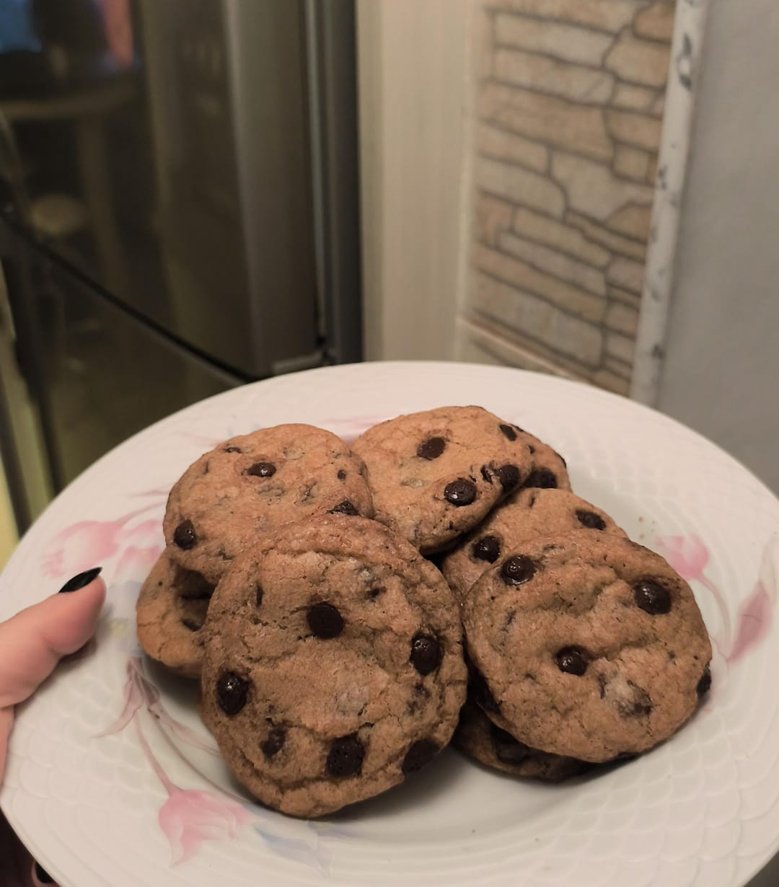

# CURSO DE INTRODUCCION A LA PROGRAMACION
## MODULO 1
- HTML Y CSS
1. Clase 1 - INTRODUCCION A HTML, SINTAXIS BASICA
2. Clase 2 - REPASO INTRODUCCION A CSS
3. Clase 3 - INTRODUCCION A GIT - MARKDOWN
[IMAGEN](https://en.wikipedia.org/wiki/Cookie)
